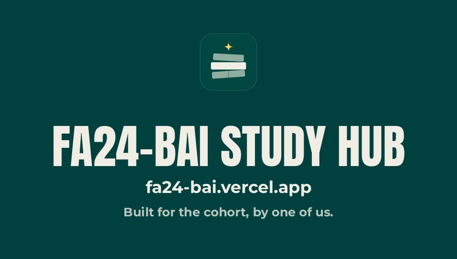

<p align="center">
  
</p>

# FA24-BAI 5th Semester Study Hub

A modern web portal for the FA24-BAI cohort (BS Artificial Intelligence, 5th semester) to discover, search, and study semester resources — with an integrated Google Gemini AI study companion for instant summaries, practice quizzes, and viva preparation.

**Live Portal:** [fa24-bai.vercel.app](https://fa24-bai.vercel.app)

---

## Features

- **Landing Page:** Welcoming home portal under the Study Hub header (open-book logo with the stacked STUDY/HUB wordmark, nav, notices and theme toggle), with an integrated search bar, cohort stats, feature overviews, and clean course preview cards with per-course file counts.
- **Global Search:** Fast search across every material by title and full path, with ranked results, filter chips, and a `/` keyboard shortcut.
- **Course Explorer:** Structured folder hierarchy for every course — CDFs, Lab Manuals, Syllabi, Lectures, Assignments, Notes, Books, and exam papers — with breadcrumb navigation and folder shortcuts on every course card.
- **AI Study Companion:** Powered by Google Gemini. Summarize documents, generate 5-question review quizzes, compile common viva questions, or ask custom questions about a document — answers are formatted clean and plain (no raw markdown or LaTeX clutter), with per-request timeouts so a busy model never hangs the reply. Summaries are cached per file in the repository — the first summary generated for a document is shared with every student who asks afterwards, so repeat views come back in about two seconds. The Ask the Hub chat answers course questions from the same material, with a Groq-powered fallback so it stays available when the primary model is busy.
- **Dark Mode:** A full dark theme in the same cream/deep-green identity, toggle in the header, saved per device.
- **Recently Viewed:** Your last-opened materials stay one tap away, even after a refresh.
- **Resource Options Menu:** A three-dots menu on every material to open it, run AI analysis, copy a shareable direct link, or delete it (admin only).
- **Multi-Format Support:** Inline viewing for PDFs, and Microsoft Office Online integration for PowerPoint (`.pptx`, `.ppt`) and Word (`.docx`, `.doc`) documents.
- **Notice Board:** Cohort announcement board for academic alerts and deadline reminders.
- **Request a Material:** Anything missing? Request it through the [request form](https://docs.google.com/forms/d/e/1FAIpQLSe8ZaXjapeO1vaGv1k4KDVo2ziVLxygVu6pjrCC5igZB2ExGA/viewform) and the Admin will upload it.
- **Admin Management:** Password-protected uploads and deletions, verified server-side only (fail-closed), committed straight to GitHub via the REST API.
- **Fast by Default:** Course PDFs are served with short, freshness-friendly cache headers (one hour, with stale-while-revalidate) so a replaced file shows up quickly instead of going stale, and links shared on WhatsApp/social show a proper title, description, and preview image.
- **Reading Comfort:** A scroll progress bar at the top, a skip-to-content link for keyboard users, and a print stylesheet so notes print clean.
- **Custom 404 Page:** A themed not-found page (with a familiar animated face) that guides lost visitors back home.
- **Deep Links & Working Back Button:** Every course, folder, search, and material has its own shareable link (`#/course/CSC322`, `#/search?q=...`); browser Back/Forward just work.
- **New & Updated Badges:** A material shows a “New” or “Updated” badge for the first 24 hours after it is uploaded, shown right on each material card.
- **Midterm Countdown:** The home page counts down to the next exams, fed by dated exam notices on the notice board (pinned notices and category filters included).
- **Interactive Practice Quizzes:** AI quizzes are now tap-to-answer — instant right/wrong marking, explanations, a running score, and a final result with retry.
- **Bookmarks:** Star any material to save it; all saved items live in the new Saved view.
- **WhatsApp Share:** One tap shares any material (title + deep link) to WhatsApp.
- **Installable App (PWA):** Add the Study Hub to your home screen; the app shell loads instantly and previously opened materials work from cache.

---

## Courses Covered

| Course Name | Course Code |
|---|---|
| Programming for Artificial Intelligence | AIC270 |
| Knowledge Representation & Reasoning | AIC372 |
| Operating Systems | CSC322 |
| Probability & Statistics | MTH262 |
| Design and Analysis of Algorithms | CSC301 |
| Web Technologies | CSC336 |

---

## Architecture & Tech Stack

| Layer | Implementation |
|---|---|
| Frontend | Vanilla HTML5, CSS3, JavaScript (ES6+), Bootstrap Icons — no build step |
| Typography | Archivo Black (display / headings) · Helvetica ('Helvetica Neue', Helvetica, Arial, sans-serif) for body text |
| Backend | Vercel Serverless Functions (`/api`) |
| AI Integration | Google Gemini API (document analysis) · Groq API (Ask the Hub fallback) |
| Document Storage | This GitHub repository (GitHub Contents API). The materials list itself is a static `files.json` in the repo root, kept in sync by the upload/delete endpoints, so page loads make no live GitHub API calls |
| Hosting | Vercel |

### API Endpoints

| Endpoint | Method | Payload / Query | Description |
|---|---|---|---|
| `/api/files` | GET | None | Serves the static materials list (`files.json`, via a rewrite) |
| `/api/ask` | POST | `filename`, `action` (`summarize`, `quiz`, `viva`), `prompt`, `password` (admin verification) | Generates AI analysis, or validates the admin key server-side |
| `/api/upload` | POST | `filename`, `contentBase64`, `password`, `folder` | Commits a new resource to the repository (supports overwriting) |
| `/api/delete` | POST | `filename`, `password` | Deletes a resource from the repository |
| `/api/notices` | GET / POST | `password` (POST only) | Reads the notice board, or posts a new announcement (admin only); notices can carry an exam date, category, and pin |

All admin endpoints fail closed: if `ADMIN_PASSWORD` is not configured on the server, they refuse every request. The AI endpoint is also rate-limited per IP (20 AI requests and 10 admin login attempts per minute) to keep shared quotas safe during exam-week rushes.

---

## Setup & Deployment

### 1. Fork or Clone

```bash
git clone https://github.com/abduIwahid/fa24-bai.git
cd fa24-bai
```

### 2. Configure Environment Variables

When deploying to [Vercel](https://vercel.com), configure the following environment variables:

| Variable | Required | Description |
|---|---|---|
| `GEMINI_API_KEY` | Yes | API key from Google AI Studio for the AI study features |
| `GITHUB_TOKEN` | Yes | GitHub Personal Access Token with repository read/write permissions |
| `ADMIN_PASSWORD` | Yes | Master authorization key for admin upload/delete operations — keep it secret and rotate it if it is ever exposed |
| `GROQ_API_KEY` | No | Enables the Groq fallback models for the Ask the Hub chat |

### 3. Local Development

```bash
npm install
npm i -g vercel
vercel dev
```

---

## Resource Organization Guidelines

Resources uploaded via the Admin Portal or Pull Request follow this directory structure:

```
5th Semester/<COURSE_NAME>/<RESOURCE_TYPE>/<FILENAME>
```

Examples:
- `5th Semester/OS/Lab Manual/CSC322_OS_Lab Manual_V3.1.pdf`
- `5th Semester/PfAI/Lectures/PfAI_Lecture_01.pptx`

Course mapping and resource types are recognized automatically based on path keywords:
- **Courses:** `PfAI`, `AIC270`, `KRR`, `AIC372`, `OS`, `CSC322`, `STAT`, `MTH262`, `DAA`, `CSC301`, `WEB`, `CSC336`
- **Resource Types:** `CDF`, `Lab Manual`, `Syllabus`, `Lectures`, `Assignments`, `Notes`

---

## Maintainer

Maintained by the FA24-BAI Study Hub Admin.
Copyright (c) 2026 FA24-BAI. All rights reserved.

<!-- redeploy: env rotation 2026-10-23 -->
